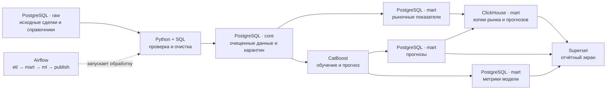

# Smart Logistics

Локальная аналитика тарифов: PostgreSQL → очистка данных → рыночные витрины и CatBoost
→ ClickHouse → Superset. Airflow ежедневно обновляет результаты.

## Архитектура решения


PostgreSQL хранит источник, очищенные данные и результаты расчётов. В схеме `ops`
записываются этапы обработки и причины ошибок. Рыночная витрина имеет одну строку
на месяц, отправление, назначение, группу кузова и весовую категорию; таблица
прогнозов — одну строку на заявку и дату снимка.

После расчётов две витрины копируются в ClickHouse порциями по 10 000 строк через
временные таблицы с последующей заменой. Superset читает рынок из ClickHouse,
прогнозы и качество модели — из PostgreSQL. Airflow выполняет четыре этапа по порядку
ежедневно в 02:30 UTC (05:30 по Москве), с двумя повторами при ошибке.

Метаданные Airflow и Superset находятся в отдельных базах того же PostgreSQL.
Данные хранилищ, модели и журналы сохраняются в Docker-томах. Повторная обработка
заменяет результаты без дублей; при ошибке изменения этапа в PostgreSQL отменяются.

## Почему выбран этот стек

| Компонент | Обоснование |
| --- | --- |
| PostgreSQL 17 | Основное хранилище: транзакции и ограничения защищают целостность, SQL позволяет явно описать очистку, точные квартили и календарные сравнения |
| ClickHouse, MergeTree | Отдельный аналитический слой для чтения маршрутных показателей; разделение по месяцам и сортировка по измерениям соответствуют запросам отчёта |
| Apache Airflow, LocalExecutor | Расписание, зависимости, повторы и журнал задач видны в одном интерфейсе, для локального проекта не нужны отдельные очередь и рабочие серверы |
| CatBoostRegressor | Подходит для табличных данных с числовыми и категориальными признаками, города, регионы и кузова передаются как категории без отдельного кодировщика |
| Apache Superset | Позволяет подключить обе СУБД и показать фильтры, рыночный коридор, доказательную базу и прогнозы без отдельного веб-приложения |
| Python 3.11 и Docker Compose | Python связывает SQL и модель, Compose воспроизводимо запускает все сервисы, образы и версии библиотек закреплены |

Расчёты остаются в PostgreSQL, а ClickHouse получает их готовые копии: бизнес-правила
не приходится реализовывать отдельно в двух СУБД. Модель обучается по времени, 
проверочная выборка не используется для обучения и подбора параметров.

## Пошаговый запуск

1. Скачайте репозиторий или распакуйте архив и откройте терминал в папке,
   где находится `docker-compose.yml`. Запустите Docker.(ужен Compose **2.24+**). Проверить инструменты:

   ```bash
   docker --version
   docker compose version
   ```

2. Для стандартного запуска используйте готовый `.env.example` — Compose читает
   его автоматически.  Для собственных настроек
   можно скопировать `.env.example` в `.env` и изменить значения; они имеют приоритет.
   На существующих томах сохраняются ранее созданные пользователи и их пароли.

3. Проверьте конфигурацию, соберите образы и запустите сервисы:

   ```bash
   docker compose config --quiet
   docker compose up --build -d
   ```

   Первый запуск создаёт 300 000 исходных сделок, очищенные таблицы, рыночную
   витрину, модель, прогнозы и отчётный экран. Дополнительные команды инициализации
   не нужны. Также поддерживается команда `docker-compose up`.

4. Дождитесь завершения обработки и готовности интерфейсов:

   ```bash
   docker compose ps -a
   docker compose logs --tail=50 pipeline
   ```

   Ожидаемые состояния: `pipeline` — **Exited (0)**; `postgres`, `clickhouse`,
   `airflow-webserver`, `airflow-scheduler`, `superset` — **healthy**.
   `pipeline` является одноразовой задачей и после успеха не должен работать постоянно.

5. Откройте Superset и Airflow по адресам из следующего раздела. В Superset
   выберите маршрут, кузов и вес; в Airflow откройте расписание `logistics_daily`.
   Проверить количество строк и качество модели можно командой `make status`.
   Автотесты запускаются через `make test`; после успешного первого выполнения
   расписания сквозная проверка доступна через `make verify`.

Остановить сервисы с сохранением данных: `docker compose down`. Последующий
`docker compose up -d` использует сохранённые тома и повторяет обработку.

## Доступ для проверки проекта

При новом развёртывании используются **фиксированные учебные пароли** из
[.env.example](.env.example), который хранится в Git и автоматически читается Compose.
Копировать или создавать `.env` для проверки не требуется. Пароли не генерируются
и сохраняются между перезапусками.

| Сервис | Адрес | Логин | Пароль |
| --- | --- | --- | --- |
| Superset | [Рыночные ставки](http://localhost:8088/superset/dashboard/smart-logistics/) | `admin` | `local-superset` |
| Airflow | [Расписание logistics_daily](http://localhost:8080) | `admin` | `local-airflow` |
| PostgreSQL | `localhost:5432`, база `deals_bigdata` | `logistics` | `local-postgres` |
| ClickHouse | `localhost:8123`, база `mart` | `logistics` | `local-clickhouse` |

Служебный пользователь `bi_reader` читает витрины в обеих базах с паролем
`local-reader`; Superset подключается под ним автоматически.

## Структура проекта

```text
etl/                загрузка, проверки и публикация данных
ml/                 признаки, обучение и прогнозы
sql/source/         исходная схема и генератор задания
sql/core/           таблицы очищенных данных и их загрузка
sql/mart/           таблицы показателей и расчёт рынка в PostgreSQL
sql/clickhouse/     явная схема аналитического хранилища

dags/               ежедневное расписание Airflow
docker/airflow/     образ и запуск Airflow и обработки данных
docker/superset/    образ, настройки и отчётный экран Superset
docker/clickhouse/  настройки памяти ClickHouse

tests/              проверки правил задания
reports/            сохранённые результаты проверки
attachments/        исходные приложения задания
```

```bash
make status                         # число строк и метрики модели
make test                           # проверки в отдельных временных базах
make lint                           # проверка Python
make verify                         # сравнение хранилищ, повторяемости и доступности сервисов
make backfill START=2026-09-01 END=2026-10-01

docker compose ps -a                # состояние контейнеров
docker compose logs --tail=50 pipeline
docker compose down                 # остановка с сохранением данных
```

Пересчёт периода включает начало и не включает конец; последующие этапы строятся
по всем очищенным данным. Дата снимка — **26.10.2026**, а не текущий день.
Последний день снимка ещё не прошёл исходную разметку выбросов — это ограничение
данных. У будущих заявок факт и ошибки прогноза всегда пусты.

Отчёт позволяет выбрать маршрут, кузов и вес, посмотреть P25/P50/P75 за рейс и км,
число рейсов и перевозчиков, надёжность и сравнение факта с прогнозом. Таблицы
читаются постранично, графики при сбросе фильтров показывают до десяти сочетаний.

## Примеры SQL для проверки витрин

Откройте SQL Lab в Superset с подключением `Logistics · PostgreSQL` либо запустите
`psql` внутри контейнера. Команда использует имя пользователя и базы из настроек:

```bash
docker compose exec postgres sh -c 'psql -X -U "$POSTGRES_USER" -d "$POSTGRES_DB"'
```

**1. Число строк после полного запуска на стандартном наборе.**

```sql
SELECT 'raw.prices' AS table_name, count(*) AS rows FROM raw.prices
UNION ALL
SELECT 'core.prices', count(*) FROM core.prices
UNION ALL
SELECT 'core.dq_quarantine_prices', count(*) FROM core.dq_quarantine_prices
UNION ALL
SELECT 'mart.market_corridor', count(*) FROM mart.market_corridor
UNION ALL
SELECT 'mart.ml_price_predictions', count(*) FROM mart.ml_price_predictions;
```

Ожидаемые объёмы: `raw.prices` — **300 000**, `core.prices` — **299 797**,
карантин — **203**, рыночная витрина — **203 644**, прогнозы — **18 632** строк.
Проверки `raw` и `core` выполняйте через `psql`: у пользователя Superset есть доступ
только к витринам `mart`.

**2. Карточка Москва → Санкт-Петербург, Тент, FTL.**

```sql
SELECT month,
       round(p25_trip::numeric, 2) AS p25_trip,
       round(median_trip::numeric, 2) AS median_trip,
       round(p75_trip::numeric, 2) AS p75_trip,
       round(median_km::numeric, 2) AS median_km,
       trips_count, carriers_count, reliability_level,
       round(mom_pct::numeric, 2) AS mom_pct,
       round(yoy_pct::numeric, 2) AS yoy_pct
FROM mart.market_corridor
WHERE origin_city = 'Москва'
  AND destination_city = 'Санкт-Петербург'
  AND body_group = 'Тент'
  AND weight_category = 'FTL'
ORDER BY month DESC
LIMIT 6;
```

Для октября 2026 медиана составляет **88 023,20 руб./рейс**. Число рейсов нельзя
суммировать по кузовам и месяцам без проверки пересечений: одна сделка может
соответствовать нескольким кузовам или действовать несколько месяцев.

**3. Проверки корректности: каждый запрос должен вернуть 0.**

```sql
-- Нет будущих месяцев в исторической рыночной витрине.
SELECT count(*) AS future_market_rows
FROM mart.market_corridor
WHERE month > DATE '2026-10-26';

-- Нижняя граница коридора не превышает медиану, а медиана — верхнюю границу.
SELECT count(*) AS invalid_corridors
FROM mart.market_corridor
WHERE p25_trip > median_trip OR median_trip > p75_trip
   OR p25_km > median_km OR median_km > p75_km;

-- У будущих прогнозов отсутствуют фактическая цена и обе ошибки.
SELECT count(*) AS future_rows_with_actual
FROM mart.ml_price_predictions
WHERE prediction_kind = 'future'
  AND (actual_price_rub IS NOT NULL OR abs_error_rub IS NOT NULL OR ape_pct IS NOT NULL);
```

**4. Причины карантина и распределение прогнозов.**

```sql
SELECT reason, count(*) AS rows
FROM core.dq_quarantine_prices
CROSS JOIN LATERAL unnest(reasons) AS r(reason)
GROUP BY reason
ORDER BY rows DESC;

SELECT prediction_kind, count(*) AS rows, count(actual_price_rub) AS rows_with_actual
FROM mart.ml_price_predictions
WHERE as_of = DATE '2026-10-26'
GROUP BY prediction_kind
ORDER BY prediction_kind;
```

В карантине: 164 невалидные цены и 39 отсутствующих точных курсов. Одна строка
в общем случае может иметь несколько причин. Прогнозы: `test` — 12 808 строк
с фактом, `future` — 5 824 строки без факта. Карантин проверяется через `psql`.

**5. Сверка PostgreSQL и ClickHouse.** Выполните одинаковые запросы в SQL Lab
сначала для `Logistics · PostgreSQL`, затем для `Logistics · ClickHouse`:

```sql
SELECT count(*) AS rows, sum(median_trip) AS median_sum
FROM mart.market_corridor;

SELECT count(*) AS rows, sum(predicted_price_rub) AS prediction_sum
FROM mart.ml_price_predictions;
```

Количество строк должно совпасть точно; суммы — с учётом погрешности сложения
дробных чисел. `make verify` проверяет относительный допуск `1e-12` и неизменность
данных после полного повторного прогона.

## Полученные метрики ML

Прогнозируется цена рейса в рублях без НДС. На снимке **26.10.2026** модель обучена
на **24 226** фактах с 26.07.2026 включительно до 05.10.2026 не включительно.
Проверка — **12 808** фактов с 05.10.2026 по 26.10.2026 включительно.
Дополнительно рассчитано **5 824** прогноза будущих заявок.

| Метрика | Результат на проверочной выборке | Смысл |
| --- | ---: | --- |
| R2 (R²) | 0,9188 | Коэффициент детерминации, ближе к 1 — лучше |
| MAPE | 15,94% | Средняя абсолютная относительная ошибка |
| RMSE | 54 521,37 руб. | Корень средней квадратичной ошибки; сильнее учитывает большие промахи |
| MAE | 28 471,86 руб. | Средняя абсолютная ошибка |

Параметры CatBoost: 450 итераций, глубина 7, скорость обучения 0,07, функция потерь
RMSE, `random_seed=20261026`, `has_time=True`. Используются 24 разрешённых признака:
география, груз, кузов и календарные циклы. Цена, её производные и групповые
статистики не входят в признаки. Точность получена на синтетической временной
выборке; её нельзя переносить на реальные перевозки или весь год без новой проверки.

Метрики сохранены в [reports/validation.json](reports/validation.json) и доступны в БД:

```sql
SELECT model_name, as_of, train_count, test_count,
       round(r2::numeric, 4) AS r2,
       round(mape_pct::numeric, 2) AS mape_pct,
       round(rmse_rub::numeric, 2) AS rmse_rub,
       round(mae_rub::numeric, 2) AS mae_rub
FROM mart.ml_quality
WHERE as_of = DATE '2026-10-26'
ORDER BY trained_at DESC
LIMIT 1;
```
